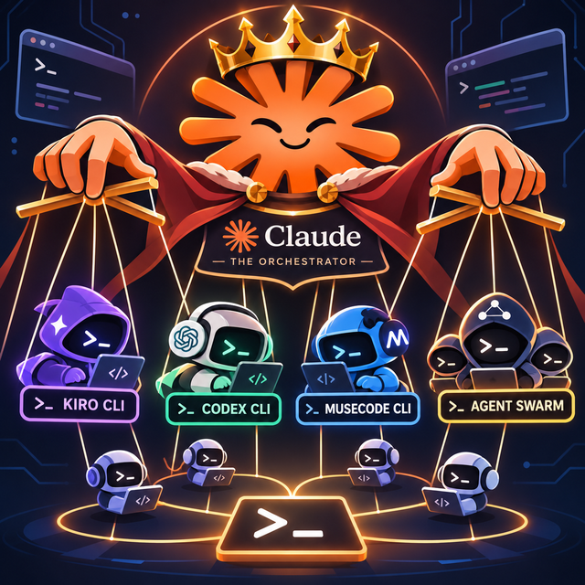

<p align="center">
  
</p>

# SwarmLord

**Claude Code orchestrates. Every CLI coding agent executes.**

SwarmLord is a Claude Code plugin that lets Claude delegate work to **many**
CLI coding agents — not just one. Claude picks the best agent for each task
from routing rules *you* control, runs it headlessly in its own git
worktree, verifies the result against the filesystem and your tests, and can
hand a task off from one agent to another mid-flight. A ledger-backed
circuit breaker stops the whole thing from deadlocking when agents loop,
revert each other, or burn budget.


```
you → Claude Code (spec · route · verify · merge)
         └─ swarmlord-delegate ─┬─ Codex        ┐
                               ├─ Gemini       │
                               ├─ Copilot      ├─ each in its own
                               ├─ Kiro         │  git worktree/branch
                               ├─ OpenCode     │
                               ├─ Muse Code    │
                               ├─ …            ┘
         └─ ledger + circuit breaker watch every run
```

## Why

Single-vendor delegation locks you into one model's price, quota, and
failure modes. With several agents installed, the useful questions become:
*which agent should do this task, what happens when it's out of quota, and
how do I know the work actually happened?* SwarmLord answers all three —
routing with fallbacks, and verification that never takes an agent's word
for anything.

## What it does

- **One entry point** — `delegate.sh --agent <name> [--dir <path>]
  [--task-type <type>] "<prompt>"`. No per-agent wrappers to learn.
- **Routing you own** — `config/routing.json` maps task types (frontend,
  backend, tests, refactor, docs, research, review) to an ordered agent
  list. Missing, unauthenticated, or quota-exhausted agents fall through to
  the next candidate automatically; a quota trip benches that agent for a
  configurable cooldown.
- **Isolation** — every run gets its own git worktree on branch
  `swarmlord/<task>-<agent>`. Only Claude merges. Ever.
- **Verification** — the wrapper diffs the worktree before/after, records
  exactly which files changed (blob hashes), optionally runs your test
  command, and can treat "replied but changed nothing" as a failure.
- **Handoff** — a failing task moves to a second agent together with a
  *capsule*: the full recorded state (runs, file changes, test results,
  errors), so the next agent continues from reality, not from a summary
  someone wrote.
- **Deadlock circuit breaker** — an append-only ledger
  (`.git/swarmlord/ledger.jsonl`) feeds detectors for state recurrence, the
  same error twice in a row, cross-agent reverts, and per-task budget
  overruns. On a trip: pause, checkpoint-commit, conflict report, and the
  user is asked. A PreToolUse hook keeps the tripped task paused.
- **Narrow permissions by default** — each adapter uses the smallest
  headless grant its CLI offers. Full-trust flags exist, are opt-in per
  run, and are documented as unsafe outside a container
  ([docs/PERMISSIONS.md](docs/PERMISSIONS.md)).

## Agents

| agent id | CLI | headless form | cost tier |
|---|---|---|---|
| `codex` | OpenAI Codex CLI (`codex`) | `codex exec` | medium |
| `kiro` | Kiro CLI (`kiro-cli`) | `kiro-cli chat --no-interactive` | medium |
| `copilot` | GitHub Copilot CLI (`copilot`) | `copilot -p` | medium |
| `gemini` | Gemini CLI (`gemini`) | `gemini -p` | low |
| `opencode` | OpenCode (`opencode`) | `opencode run` | low / BYOK |
| `command-code` | Command Code (`cmd`) | `cmd -p` | medium |
| `muse` | Muse Code, Meta (`muse`) | `muse exec` | paid (no free tier) |
| `antigravity` | Antigravity CLI (`agy`) | `agy -p` | low |
| `aider` | Aider (`aider`) | `aider --message` | BYOK |
| `goose` | Goose (`goose`) | `goose run --text` | BYOK |
| `local` | Ollama / LM Studio / any OpenAI-compatible endpoint | `POST /v1/chat/completions` | free (your hardware) |

Every command and flag above was verified against the vendor's official
docs — sources and the full capability record (permission flags, JSON
output, session resume, minimum tested version, open TODOs) live in
[`config/agents.json`](config/agents.json). The `local` adapter is
reply-only by design: use it for docs/research/review drafts, and route
local models that must edit files through goose or opencode instead.

## Install

In Claude Code, add this repository as a plugin marketplace and install:

```
/plugin marketplace add <this-repo>
/plugin install swarmlord@swarmlord
/swarmlord:setup        # health-checks every installed agent CLI
```

Prerequisites: Claude Code, `git`, `bash`, `python3`, and at least one of
the agent CLIs above, installed and authenticated (or a local endpoint for
the `local` adapter). Supported hosts: macOS, Linux, WSL. Native Windows
is not recommended for headless delegation.

## Quick start

```bash
# Routed delegation (agent picked from routing.json by task type)
swarmlord-delegate --task-type tests --dir ~/repo \
  --tests "npm test" --expect-changes \
  "Generate unit tests for the billing module"

# Explicit agent
swarmlord-delegate --agent codex --dir ~/repo "Refactor the auth middleware"

# Whole-task handoff: agent A is gated by tests; on failure agent B
# receives the task plus a capsule of everything A did
swarmlord-handoff --dir ~/repo --agent codex --handoff-to gemini \
  --tests "pytest -q" "Implement the export feature per SPEC.md"

# See a routing decision before running anything
swarmlord-route --task-type frontend
```

Slash commands: `/swarmlord:setup` · `/swarmlord:delegate` ·
`/swarmlord:handoff` · `/swarmlord:review` · `/swarmlord:research` ·
`/swarmlord:agents` · `/swarmlord:route` · `/swarmlord:status` ·
`/swarmlord:result` · `/swarmlord:cancel`.

## Configuration

- **`config/routing.json`** — task-type → ordered agents, quota cooldown,
  per-task budgets (`max_runs`, `max_handoffs`, `max_seconds`), per-run
  timeout. Override per project with `<repo>/.swarmlord/routing.json`, or
  point `$SWARMLORD_ROUTING` at any file. Details: [docs/ROUTING.md](docs/ROUTING.md).
- **`config/agents.json`** — the capability manifest. Read it before
  trusting an adapter with something new; TODO means unverified.
- **Plugin options** (Claude Code `userConfig`) — `default_agent`,
  `timeout`, `coding_policy`, `delegation_nudge`, `local_url`,
  `local_model`.

Default routing (edit freely — these are defaults, not gospel):
frontend → gemini · backend → codex · tests → copilot · refactor → codex ·
docs → gemini · research → gemini · review → copilot, each with fallbacks.

## Safety model, in one paragraph

Agents run in throwaway worktrees with narrow permission grants; their
output is treated as an unverified claim until Claude diffs it and runs the
tests; the ledger records hashes and metadata — **never prompt text** — so
runs are auditable without leaking task content; the circuit breaker and a
per-repo run lock keep parallel or looping agents from corrupting each
other's work. Full detail: [docs/ARCHITECTURE.md](docs/ARCHITECTURE.md),
[docs/PERMISSIONS.md](docs/PERMISSIONS.md), [SECURITY.md](SECURITY.md).

## Development

```bash
bash tests/run-tests.sh   # stub-based: no real agent CLI needed
```

Tests fake every agent binary (and a local LLM endpoint) and cover each
adapter's doctor/run/parse/classify, the router (including quota
cooldowns), the circuit breaker (recurrence, cross-agent reverts, repeated
errors, budgets), file claims, handoff capsules, background jobs, and full
delegate runs in scratch git repos. Adding an agent = one file in
`scripts/adapters/` from `_template.sh`, one entry in `config/agents.json`,
and stub tests. See [CONTRIBUTING.md](CONTRIBUTING.md) and
[docs/ADAPTERS.md](docs/ADAPTERS.md).

## License

MIT — see [LICENSE](LICENSE).
